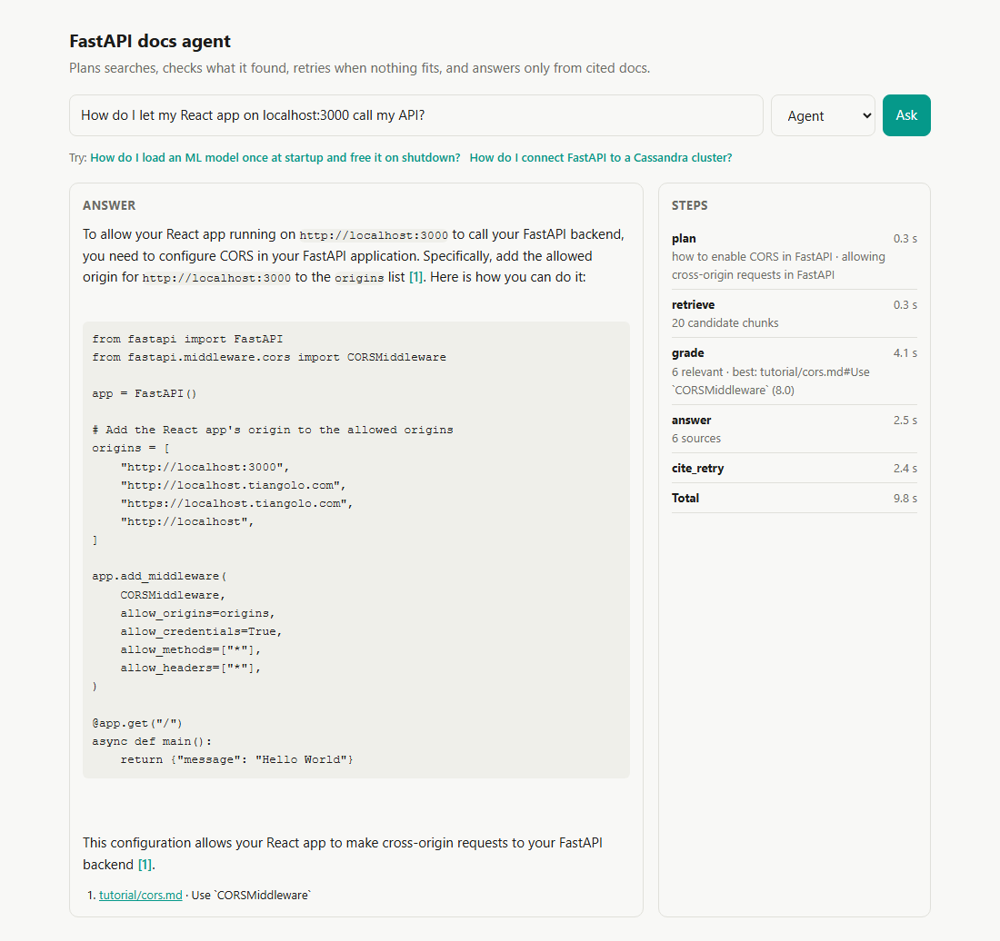

# Agentic RAG over the FastAPI docs, with evals

A question-answering agent over the FastAPI documentation, measured against a plain RAG baseline on a fixed question set. It plans search queries, searches with Postgres (pgvector plus full-text), checks what came back with a cross-encoder, retries with new queries when nothing fits, and answers only from cited sources. When the docs don't cover a question, it says so.

The point is the measurement. Every change here was kept or dropped based on the eval numbers below.



## Results

The test set has 42 questions: 38 the docs answer and 4 they don't. Everything runs locally on one RTX 4070 Ti SUPER:

- answer model: Qwen2.5-7B-Instruct via Ollama
- judge: Qwen3-14B, a different model family, never judging its own answers
- embeddings: bge-small
- reranker: MiniLM-L-12

Raw per-question grades are in `docs/results/`.

**Retrieval** (38 answerable questions, hit = a gold page in the top 5):

| Retriever | Hit@5 | MRR |
| --- | --- | --- |
| Keyword (Postgres full-text) | 65.8% | 0.514 |
| Vector (pgvector, bge-small) | 94.7% | 0.857 |
| Hybrid (RRF of both) | 94.7% | 0.783 |
| Hybrid + cross-encoder rerank | **100%** | **0.933** |

Fusing keyword results in made ranking slightly worse on these conversational questions. The reranker fixed it, so the agent uses hybrid search plus reranking.

**Answers:**

| | Agent | Plain RAG |
| --- | --- | --- |
| Expected facts covered | 92.1% | 93.4% |
| Cited answers fully backed by their sources | **81.6%** | 71.1% |
| Partly backed (a detail added) | 10.5% | 23.7% |
| Not backed (a key claim or code pattern not in the sources) | 7.9% | 5.3% |
| Citations pointing at a gold page | 77.9% | 81.7% |
| Correct refusals on the 4 out-of-scope questions | 4/4 | 4/4 |
| Answerable questions wrongly refused | 0 | 0 |
| Tokens per question | **3,042** | 4,474 |
| Latency, median / p90 | 6.9 s / 9.3 s | 2.7 s / 5.9 s |

Plain RAG is one hybrid search on the raw question and the same answer prompt, with no planning, relevance filter or retry.

What this says:

- **The agent is better grounded, not more correct.** More of its answers are fully backed by the cited text (82% vs 71%) because it answers only from chunks the reranker accepted. Fact coverage is the same within noise (92% vs 93%).
- **It costs time, not tokens.** It sends about a third fewer tokens to the LLM, but reranking 20 chunks against the question and each planned query runs on the CPU. That makes it 2.5x slower here. On a GPU or with a smaller pool this would shrink.
- **Citation precision is a little lower.** The agent pulls in related pages, for example the security pages for a login question, that are correct but not on the gold list.
- **38 questions is small.** One question is about 2.6 points, so treat differences under ~5 points as noise.

How the numbers got here, because the first versions were wrong:

1. **The first grader was Llama 3.1 8B,** and it marked answers copied straight from the docs as unsupported. Asking the judge to list unsupported claims first, then moving to Qwen3-14B, gave verdicts that check out when read by hand. Qwen3 also returns an empty object in Ollama's JSON mode, so it is called without it.
2. **The 7B model left out citations in a third of its answers.** One retry that only adds the [n] markers brought cited answers to 100%. The retry used to put markers inside code blocks, so those are now stripped there.
3. **Testing the UI by hand found a real miss.** "Let my React app on localhost:3000 call my API" never mentions CORS. The planner searched for CORS, but the reranker only compared chunks with the raw question and rejected them all. Chunks now keep their best score across the question and the planned queries. Fact coverage went from 85% to 92%.
4. **The relevance threshold (-1.0) was picked from score distributions on this same set.** A held-out set would be better.

Where the agent still goes wrong, from the graded answers:

- It invented a custom HTML response class instead of using `HTMLResponse`.
- It muddled the async-vs-def advice.
- It dropped install notes such as `python-multipart`, which counts as a missed fact.


## How it works

```
question -> plan (LLM: 1-3 search queries)
         -> retrieve (hybrid: pgvector cosine + Postgres full-text, fused with RRF; 20 candidates)
         -> grade (cross-encoder reranker; keep chunks above a score threshold)
              nothing relevant and no retry yet -> rewrite (LLM: new queries) -> retrieve again
         -> answer (LLM, numbered sources, inline [n] citations; refuses when sources are empty)
```

- **Built with LangGraph as a fixed graph, not free-form tool calling.** Every LLM decision is a small JSON reply, so a 7B local model behaves predictably.
- **Relevance is judged by a cross-encoder, not the LLM,** scoring each chunk against the question and the planner's queries. In testing, a 3B model marked the correct CORS section irrelevant, searched again and then answered from the wrong page with a made-up function. A reranker reading question and chunk together is faster and doesn't do that.
- **The planner never skips the search.** Small models misjudge what is on topic, so the grader decides instead.
- **Citations are checked.** `[n]` markers that point past the sources are removed before the answer is returned.

## Data

The FastAPI docs (MIT licence), pinned to commit `ba47d6d`. That is 116 pages and 1,107 chunks, split on `##` and `###` headings at 280 words or less. Code blocks are never split. The docs pull code samples in with an include syntax, and those are inlined, because the code is usually the answer to a "how do I" question. Release notes, translations and people pages are left out.

## Eval set

`evals/questions.jsonl` has 42 questions written against the docs:

- 33 single-page questions
- 5 multi-part questions
- 4 the docs can't answer, such as Kafka, Cassandra, slowapi and the weather

Each answerable question lists its gold page(s) and the key facts a correct answer must contain. `evals/check_questions.py` verifies that every gold page exists and every literal fact appears on it.

- `evals/retrieval_eval.py` measures hit@5 and MRR per retriever, with no LLM. The CI workflow runs it after the unit tests and fails if hybrid hit@5 drops below 0.9.
- `evals/agent_eval.py` runs the agent and the plain baseline on every question. A judge model from a different family checks fact coverage and whether every claim is backed by the cited sources. It also records citation precision, refusals, latency and tokens.

## Run it

```bash
docker compose up -d db                          # Postgres 16 + pgvector on 127.0.0.1:5442
python -m venv .venv && .venv/bin/pip install -r requirements.txt
cp .env.example .env                             # point LLM_BASE_URL at any OpenAI-compatible endpoint
git clone --filter=blob:none --sparse https://github.com/fastapi/fastapi.git data/fastapi-src
git -C data/fastapi-src sparse-checkout set docs/en/docs docs_src
python -m rag.ingest --docs data/fastapi-src --reset
python -m evals.retrieval_eval
python -m evals.agent_eval answer --mode agent plain   # needs LLM_MODEL
python -m evals.agent_eval grade --mode agent plain    # needs JUDGE_MODEL
uvicorn rag.api:app --port 8800                  # POST /ask streams steps as server-sent events
cd web && npm install && npm run dev             # UI on http://localhost:3000
```

## Layout

```
rag/ingest.py         clean, chunk, embed (fastembed bge-small, CPU), store
rag/retrieve.py       vector, keyword, hybrid (RRF), hybrid + rerank
rag/rerank.py         cross-encoder (MiniLM-L-12, CPU)
evals/calibrate_rerank.py  score distributions used to pick the relevance threshold
rag/agent.py          LangGraph agent and the plain-RAG baseline
rag/api.py            FastAPI with streaming steps
web/                  Next.js UI: live step trace, answer with linked citations
evals/                question set, retrieval eval, agent eval with judge
.github/workflows/    tests and retrieval eval (run from the Actions tab)
```
